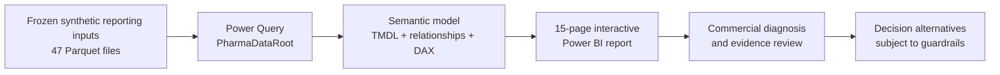

<div align="center">

# Pharma360
### Operational Pharmacy Analytics · Synthetic Public Case Study

**Category Performance · Inventory & Expiry · Supplier Service · Forecast Evaluation · Governed Decisions**

**Applied Operational Analytics · Power BI · PBIP / PBIR / TMDL · DAX · Power Query · Synthetic Data**

[**Explore the dashboards**](#dashboard-showcase) · [**Run the report**](#run-the-dashboard) · [**Understand the evidence**](#evidence-and-interpretation) · [**Browse the files**](#repository-map)

**Prepared by [Khaled Zidan](https://github.com/khaledzidan203-stack)**

</div>

> [!IMPORTANT]
> **Based on pharmacy analytics implemented in real operations — recreated here with synthetic data.** The underlying business reporting and operational decision-support approach comes from practical pharmacy operations work. This public GitHub edition uses fictional pharmacies, products, suppliers, invoices and inventory movements to demonstrate the approach without disclosing real business data. It is an interactive, runnable case study rather than a live connection to operational systems. Forecast experiments and simulated policy alternatives are not evidence of production-approved automated decisions.

## Dashboard showcase

**01 · Executive Overview** — One executive view of commercial performance, profitability, inventory exposure and decision signals.


### Explore the core decision areas

| **02 · CATEGORY PERFORMANCE & PROFITABILITY** | **05 · INVENTORY & DISTRIBUTION NETWORK** |
|:---:|:---:|
|  |  |
| Category mix, margins and profit contribution | Retail, DC, in-transit and available stock |

| **11 · FORECAST PERFORMANCE** | **13 · POLICY SCENARIOS & GUARDRAILS** |
|:---:|:---:|
|  |  |
| Forecast accuracy and provenance limitations | Scenario comparisons, permissions and safeguards |

<details>
<summary><strong>View all 10 remaining Power BI pages — including the Index and evidence review</strong></summary>

| **00 · INDEX** | **03 · BRANCH PERFORMANCE** |
|:---:|:---:|
|  |  |
| Navigate the full decision-intelligence report | Store-level performance and concentration |

| **04 · SKU & ASSORTMENT** | **06 · EXPIRY, WITHDRAWAL & QUALITY** |
|:---:|:---:|
|  |  |
| Assortment economics and SKU prioritization | Lot-level risk and inventory quality |

| **07 · EXPIRY & WITHDRAWAL DECISION REVIEW** | **08 · SUPPLIER PERFORMANCE & RETURNS** |
|:---:|:---:|
|  |  |
| Reviewable expiry and withdrawal cases | Supplier service, receipts, claims and returns |

| **09 · REPLENISHMENT & CONSTRAINT INTELLIGENCE** | **10 · ROS, EXPOSURE & AVAILABILITY** |
|:---:|:---:|
|  |  |
| Supply constraints and governed replenishment | Rate of sale, censored exposure and availability |

| **12 · DECISION REVIEW WORKBENCH** | **14 · DATA QUALITY, EVIDENCE & METHODS** |
|:---:|:---:|
|  |  |
| Non-executable decision alternatives and review status | Evidence completeness, definitions and methods |

</details>

All **15 screenshots** are preserved report captures from the final PBIP, presented in the report's saved display order. The images are previews; the downloadable Power BI project provides the interactive slicers, measures and navigation.

## The business problem

### From operational implementation to a public case study

This project draws on analytical reporting and business workflows **applied in real pharmacy operations**: tracking commercial performance, monitoring pharmacy and distribution inventory, reviewing stock risks, and supporting management decisions. The repository reconstructs representative examples using **fully synthetic data**, allowing visitors to explore the solution and its Power BI implementation without exposing employer records, commercial transactions or confidential operational systems. The exact public dataset and experimental scenarios are not presented as real production results.

A pharmacy network cannot manage commercial performance independently from inventory, supplier service, expiry risk and forecast uncertainty. The question is not simply *which action looks profitable?* It is **which conclusion is supported by the available data, and which proposed action is actually permitted?**

Pharma360 connects:

- **Commercial intelligence:** network, branch, category and SKU sales; COGS; gross profit and margin; invoice-based average basket value; comparisons and inventory productivity.
- **Stock and quality:** physical, saleable, held, reserved, available-to-promise (ATP), distribution-center and in-transit positions; lot-level expiry and withdrawal exposure.
- **Supplier performance:** ordered and received quantities, receipt timeliness, returns, claims and credit evidence.
- **Forecast diagnostics:** observed/fulfilled demand proxies, rate of sale, stock exposure, evaluation horizons and model limitations.
- **Decision governance:** constrained alternatives, review states, evidence availability, policy guardrails and non-executable outcomes.

### At a glance

| Component | Included in this release |
|---|---|
| Interactive report | **15 Power BI pages**, **277 saved PBIR visual definitions**, **14 Index destinations** |
| Bundled input | **47 actively imported Parquet files** — all required for the existing semantic model |
| Real-world foundation | Pharmacy analytics methods implemented in day-to-day operations; synthetic reconstruction for public sharing |
| Public example network | **25 synthetic stores · 280 SKUs · 8 categories · 10 suppliers** |
| Editable source | Native **PBIP + PBIR + TMDL**, DAX measures and report theme |
| Opening the report | Windows launcher configures local `PharmaDataRoot`, then opens Power BI Desktop |
| Independent recreation | **Not claimed** — the full original world-generation and evaluation pipeline is not published in this runnable-report bundle |

## Analytical architecture



The analytical architecture reflects an operational reporting approach developed through practical pharmacy work. The Parquet inputs are the **synthetic public example**, not exported operational records. Downloading this repository **does not rerun** the original simulations, optimizer studies, historical data engineering or forecast-model selection. It reproduces the supplied interactive report using the bundled inputs, not an independently rebuilt world or a live company system.

## Run the dashboard

**Requirements:** Windows and a version of **Microsoft Power BI Desktop** supporting PBIP/PBIR/TMDL. Python, a database server and cloud credentials are **not required** to view the bundled report.

1. [Download the complete repository ZIP](https://github.com/khaledzidan203-stack/pharma360-pharmacy-network-intelligence/archive/refs/heads/main.zip) and extract it fully to a writable folder. Alternatively, clone the repository.
2. From the extracted root, double-click **`RUN_PHARMA360.cmd`**.
3. In Power BI Desktop select **Home → Refresh**. Allow the data import to finish, and review the report.
4. Use the **00 INDEX** page to navigate the 14 destinations. Check the 06 ↔ 07 review links, filters and EGP presentation.
5. **Save → Close → Reopen** to confirm the refreshed report continues to work.

To verify the bundled data paths before opening, run:

```powershell
.\RUN_PHARMA360.cmd --verify-only
```

The launcher detects its own folder, verifies all active Parquet dependencies, and updates **only** the local `PharmaDataRoot` text parameter when necessary. It creates a local rollback copy before a parameter change. If a path update is needed, close Power BI Desktop first. Keep the `data/`, `powerbi/` and `tools/` folders together.

**Verification boundary:** the owner confirmed successful local Desktop operation. A separate fresh-ZIP, cross-folder or cross-device Power BI refresh has **not yet been independently certified**.

## Evidence and interpretation

**Operational application and analytical validation are different claims.** The project is grounded in real pharmacy analytics work; the publicly available figures, simulated policies and scientific evaluation belong to the synthetic case study. The repository does not claim that every experimental module was deployed or approved in a production pharmacy system.

<details>
<summary><strong>Scientific and business limitations — important when interpreting the dashboard</strong></summary>

- **Synthetic financial labels:** visible **EGP** is a presentation relabel of the original nominal synthetic amounts, **1:1 without any foreign-exchange calculation**. Some historical measure identifiers still contain `SAR` and are not independent evidence of a currency conversion. Certain financial source fields are stored as integer minor units and converted by the existing measure definitions.
- **Accounting grains:** invoices are counted at the distinct invoice-header grain, not summed as product-line or category invoices. Stock snapshots are not additive across dates. Financial and inventory comparisons require consistent period, ownership, lot, location and as-of filters.
- **Scope differences:** a final static review noted **763 units at a wider network scope** versus **584 at retail scope** for expiry/withdrawal-related views. They are not interchangeable figures; a fully aligned reconciliation of their filters and populations was not claimed.
- **Evidence completeness:** **21 of 24** source cases were proven, **2 not observed** and **1 unverifiable**, corresponding to **87.5%** (displayed as **88%**). Unavailable evidence must not be presented as a measured business zero.
- **Forecasts:** evaluation is based on observed/fulfilled sales proxies, not independently known latent demand. Known source-calendar/provenance limitations mean that forecast scientific certification remains **ON HOLD / NOT CERTIFIED**.
- **Policy decisions:** simulation results are not realized clinical or business effects. Existing safety guardrails block operational execution of the reviewed alternatives; no live procurement, stock transfers, returns or disposal are authorized.
- **Financial comparison caveats:** previously flagged differences in margin precision, unequal compared-period day counts and GMROI denominator grain require aligned-context investigation before interpreting small discrepancies as substantive business results.

</details>

**Interpretation principle:** observed KPIs describe the synthetic network; model outputs suggest alternatives; evidence and constraints determine whether any conclusion is supportable. **A suggestion is not an authorization.**

## Repository map

```text
.
├── README.md                         Portfolio case study and dashboard gallery
├── RUN_PHARMA360.cmd                 Windows launch entry point
├── .gitignore                        Explicit public-file allowlist protection
├── tools/
│   └── launch_pharma360.ps1          Validates inputs and configures local data root
├── powerbi/
│   ├── Pharma_Category_Management_POC.pbip
│   ├── Pharma_Category_Management_POC.Report/
│   └── Pharma_Category_Management_POC.SemanticModel/
├── data/                             47 required synthetic Parquet inputs
└── screen_shoots/                    15 original report-page PNGs
```

**Publication scope:** this repository is a **runnable public edition of an operationally grounded pharmacy analytics project**, reconstructed with synthetic inputs. It does not include company data, local Codex prompts, development plans, scratch files, private QA logs, source-generating scripts or the full upstream analytics pipeline. The many JSON and TMDL files under `powerbi/` are native components of the editable report and should not be removed merely to reduce the file count.

---

**Developed by [Khaled Zidan](https://github.com/khaledzidan203-stack)** · [GitHub portfolio](https://github.com/khaledzidan203-stack) · [LinkedIn](https://www.linkedin.com/in/khaled-zidan-7400a51a3)
